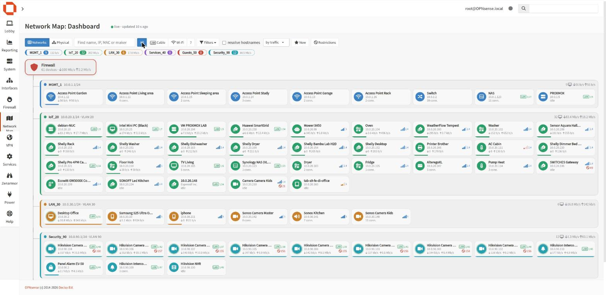
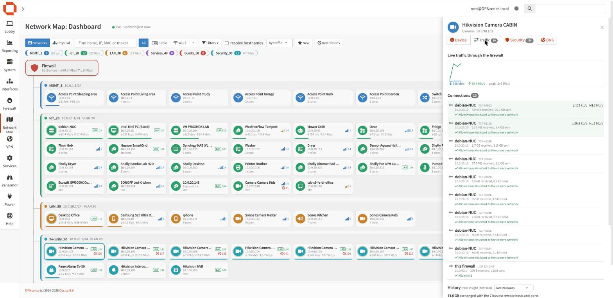
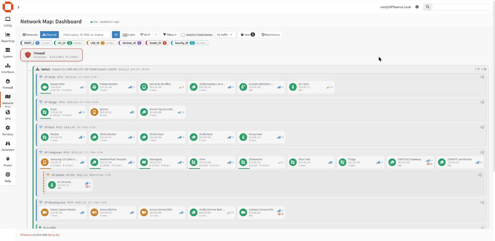
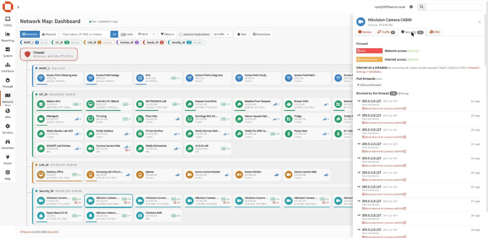
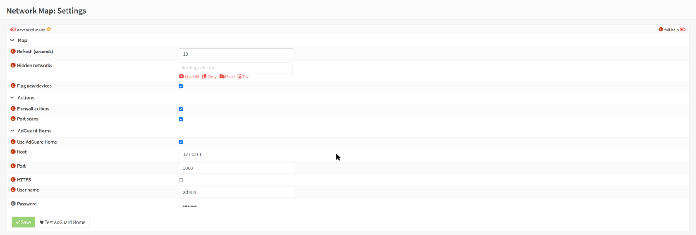

<p align="center"></p>

<h1 align="center">os-netmap</h1>

<p align="center">A live network map for OPNsense: every device, how it is connected, what it talks to and what the firewall does about it.</p>

<p align="center"></p>

## Overview

os-netmap adds **Network Map** to the OPNsense menu. Devices are discovered
from data the firewall already has (host discovery, DHCP leases, ARP) and
shown per network, with a kind and icon guessed from their name and
manufacturer. Selecting a device opens a panel with its live traffic, DNS
activity, firewall rules and the actions that apply to it.

It works with OPNsense alone. Each optional companion below, when present,
adds more detail.

## Features

| Area | What you get |
|---|---|
| **Map** | Devices grouped by network (VLAN), live traffic, blocked packets, new-device flag, filters by network, kind, group and activity, search by name, IP, MAC or manufacturer |
| **Device panel** | Live traffic chart, open connections with remote hosts named from the DNS cache, blocked packets with the rule that blocked them, 24 h / 7 d / 30 d history |
| **Identity** | Rename, choose the kind and icon, notes, groups, approval of new devices |
| **Firewall** | Ban, block Internet (always or on a schedule), port forwards, the rules that apply to the device with an on/off switch and a link to the rule |
| **DHCP** | Kea reservation of the device: create, edit, delete |
| **DNS** | Domains queried, blocked domains, block or allow a domain for one device or the whole network, block DNS for a device |
| **Open ports** | Quick or full scan, services and versions, changes between scans, kept per device |
| **Wake-on-LAN** | One-click wake |

All changes go through the standard OPNsense API with the privileges of the
logged-in user, and every destructive action asks for confirmation.

## Optional companions

| Companion | Adds |
|---|---|
| **Kea DHCP** (core) | Reservations: see, create, edit and delete the fixed address of a device |
| **nmap** (`pkg install nmap`) | Port scans of devices on the networks attached to the firewall |
| **AdGuard Home** (on the firewall or another host) | DNS queries per device and per-domain block/allow rules |
| **Insight** (Reporting > NetFlow) | Traffic history per device and the remote hosts it talked to most |
| **os-wol** | Wake-on-LAN button |
| **[os-instanton](https://github.com/itsjustdeepred/os-instanton)** | For HPE Networking Instant On networks: physical view (firewall → switches → access points → devices), cable or Wi-Fi, switch port, speed, PoE and Wi-Fi signal per device, more reliable device kinds |

Without os-instanton the map cannot tell how a device reaches the switch;
everything else works the same.

## Screenshots

| | |
|---|---|
|  |  |
|  |  |

## Privacy

* No telemetry, analytics or tracking of any kind.
* The browser only talks to the firewall. The firewall only talks to the
  services configured in the plugin settings (for example AdGuard Home).
* Port scans run on the firewall, only towards private addresses of the
  networks attached to it, never towards the uplink, VPNs or the firewall
  itself.
* Names, kinds and notes are stored in the firewall configuration
  (`config.xml`); scan results in `/var/db/netmap`.

## Installation

### From the package repository

```sh
fetch -o /usr/local/etc/pkg/repos/netmap.conf \
    https://raw.githubusercontent.com/itsjustdeepred/os-netmap/main/packaging/netmap.conf
pkg update -r netmap
pkg install os-netmap
```

The plugin then also appears in **System > Firmware > Plugins** and is
updated with the firewall. Packages are built for FreeBSD 14 and 15
(OPNsense community and business releases).

### From source

```sh
git clone https://github.com/itsjustdeepred/os-netmap.git
cd os-netmap && sh install.sh      # as root; sh uninstall.sh removes it
```

Then open **Network Map > Dashboard** and, if needed, **Network Map >
Settings**.

## Permissions

| ACL | Grants |
|---|---|
| Reporting: Network Map | The map and read access to the data it shows |
| Reporting: Network Map: scan devices | Starting port scans |

Firewall, DHCP and DNS changes additionally need the privileges of the
corresponding OPNsense pages.

## Limits

The firewall sees only traffic that crosses it: traffic between two devices
on the same network goes through the switch and is not counted. Blocked
packets appear for rules with logging enabled and for the default block
rules.

## Tested with

* OPNsense 26.10 (FreeBSD 15.1)
* Kea DHCP, Unbound DNS, AdGuard Home, Insight, nmap
* os-instanton 1.0 with an Instant On 1960 switch and AP22 / AP25 access points

Other versions and setups should work but have not been tested yet.
Feedback, suggestions and pull requests are welcome.

## Development

```sh
python3 -m unittest discover -s tests
node tests/test_netmap.js
```

Packages are built by `packaging/build.sh` on FreeBSD and published by the
GitHub workflow on every `v*` tag.

## License

BSD 2-Clause, the license used by OPNsense. See [LICENSE](LICENSE).
